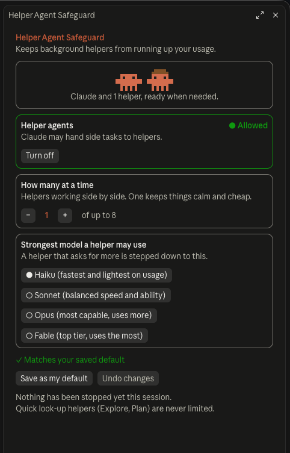
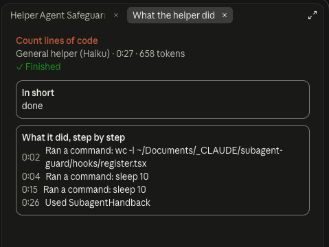

# Claude Helper Agent Safeguard (Mod)

**Keep Claude's background helpers from running up your usage, and watch them work.**

When Claude hands a side task to a helper agent (a "subagent"), it can start several at once, on a powerful model, without you noticing. This mod puts you in charge: you choose how many helpers may work at the same time and the strongest model they may use. A small pane shows each helper working, live, with a plain-language summary of what it did when it finishes.

> Unofficial community mod. Not affiliated with, endorsed by, or sponsored by Anthropic.

## A quick look

**Ready and waiting.** Claude and its resting helpers sit in the pen at the top. Below are your three settings: whether helpers are allowed, how many at once, and the strongest model they may use.

<p align="center">
  
</p>

**Out working.** Each helper's crab leaves the pen and gets its own row, with what it's doing right now, how many steps it has taken, and a running clock.

<p align="center">
  
</p>

**Finished.** The crabs head home. Each row keeps its time and token count, and a click opens a plain-language account of what it did.

<p align="center">
  
</p>

**What it did.** A short summary from the helper itself, then a timed, step-by-step list.

<p align="center">
  
</p>

## What it does

- **Limits how many helpers run at once.** Default is 1; you can allow up to 8.
- **Caps the model helpers may use.** Default is Haiku. A helper that asks for something stronger is stepped down to your cap.
- **Can turn helpers off completely.** Claude then does everything itself, in one place.
- **Shows live activity.** A crab for Claude, plus one hatted crab per helper. Each helper's row shows its task, model, what it is doing right now, time and tokens.
- **Explains what happened.** Click **"N steps taken ›"** (or the task name) for a plain-language summary and a step-by-step list.
- **Remembers your choices.** "Save as my default" keeps your settings for every new session on that device.
- **Stays out of the way.** Quick look-up helpers (Explore, Plan) are never limited.

## Install

You need the Claude Code command-line tool on the computer. If typing `claude --version` in a terminal (PowerShell on Windows) prints a version number, you have it. Otherwise, follow the install steps at <https://docs.claude.com/en/docs/claude-code/setup>.

Then run these two commands in a terminal, one after the other:

```
claude plugin marketplace add SteveAnthonyFM/subagent-guard
claude plugin install subagent-guard@subagent-guard
```

Fully quit and reopen the Claude desktop app. The pane never opens by itself: type `/subagents` whenever you want to see it. Your settings are always visible in the status line under the prompt, and the limits work whether or not the pane is open.

Works on macOS and Windows (installed and tested on both). Requires a recent version of Claude Code and the Claude desktop app, since it draws a side pane.

## Use

Just work as you normally do. Open the pane any time with:

```
/subagents
```

You can also change things by typing:

| Command | What it does |
|---|---|
| `/subagents status` | Show the current settings and how many helpers were stopped |
| `/subagents on` / `off` | Allow or forbid helpers |
| `/subagents max 2` | Allow up to 2 helpers at once (1 to 8) |
| `/subagents model sonnet` | Strongest model a helper may use: `haiku`, `sonnet`, `opus` or `fable` |
| `/subagents save` | Keep the current settings as your default |
| `/subagents reset` | Go back to your saved default |

## How it decides

1. A helper is about to start. If helpers are turned off, or you're already at your limit, it is **refused**, and Claude is told to do the work itself.
2. Otherwise, if the helper asked for (or would inherit) a model stronger than your cap, it is **stepped down** to the cap.
3. Otherwise it starts as normal. Either way, it appears in the pane.

## Good to know

- **It limits helpers that run at the same time, not the total.** You can still have many, one after another.
- **A helper's own fixed model may not be visible.** If a custom agent pins a stronger model in its own definition, the cap can't always see it.
- **Token counts appear when a helper finishes.** The live line and step list update as it works.
- **The pane opens only when you ask.** Type `/subagents`; it does not appear on its own.
- **Saved defaults are per device.**

## Privacy

No network access, no analytics, nothing leaves your computer. The mod keeps one small settings file (your saved default) in Claude's own plugin storage, and holds the activity list in memory for the current session only.

## Update and remove

```
claude plugin marketplace update subagent-guard
claude plugin update subagent-guard@subagent-guard
```

```
claude plugin uninstall subagent-guard@subagent-guard
```

## Troubleshooting

- **`claude` is not recognized.** Install Claude Code (see Install), then open a new terminal window.
- **No pane appears.** That's expected until you type `/subagents`. If the command isn't found, run `claude plugin list` and check that `subagent-guard` shows "enabled", then restart Claude.
- **Clicks need a second try while a helper runs.** The pane redraws once a second while a helper works; if a click doesn't land, click again.

## For developers

The mod is a single hooks module (`hooks/register.tsx`) with a state contract in `types/index.d.ts`. Check and test it with:

```
claude plugin validate .
claude plugin test .
```

See [CHANGELOG.md](CHANGELOG.md) for version history.

## License

[MIT](LICENSE). The pixel crab artwork is drawn in code for this mod.
